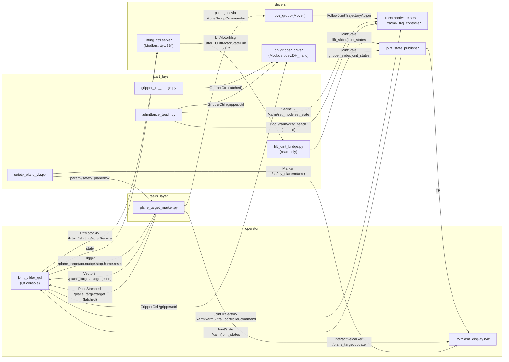

# Onboard workspace code map and upstream task integration

Scope: `/home/agilex/agilex_ws`, which is the live catkin workspace on this machine.
`ranger_arm/` is a separate git checkout that is **not** covered here; the only
reason it is mentioned is that a few contract definitions quoted below are
authoritative there.

This document answers three questions:

1. Where does the implemented code and functionality in this workspace live?
2. How does the rack-storage task (`store_apparatus`) connect to its upstream task?
3. How do the self-built nodes work internally (Part D), so a collaborator who
   has never seen this robot can follow the implementation without reading
   every script cold?

It deliberately says nothing about how complete any task is. Where a capability
is missing, it is listed as a gap in the interface surface, not as a status report.

---

# Part A — Implemented code and functionality in this workspace

`catkin_make` from the workspace root builds everything. Source ROS environment first:

```bash
source /opt/ros/noetic/setup.bash
source ~/agilex_ws/devel/setup.bash
```

## A.1 Layer index

| # | Layer | Package path (under `src/`) | Entry point |
|---|---|---|---|
| A.2 | Robot model / MoveIt | `moveit_config/ranger_xarm_lifting_moveit_config` | `realMove_exec.launch` |
| A.3 | Arm bringup + console | `start/agx_xarm_bringup` | `setup_arm.launch` |
| A.4 | Legacy AR pick/place | `core/agx_xarm_pick`, `core/agx_xarm_smach` | `demo_pick`, `send_task` service |
| A.5 | Lift column | `start/lifting_ws/src/lifting_ctrl` | `start_motor.launch` |
| A.6 | Gripper | `sensors/gripper/dh_gripper_driver` | `dh_gripper.launch` |
| A.7 | Camera / AR / IMU | `sensors/camera/*`, `sensors/imu_ch110/*` | `open_camera.launch` |
| A.8 | Lidar | `sensors/lidar/rslidar_sdk` | `open_lidar.launch` |
| A.9 | Base | `car_base/ugv_sdk`, `car_base/ranger_ros` | `ranger_mini_v2.launch` |
| A.10 | SLAM + navigation | `SLAM/*`, `start/agilexpro` | `gmapping.launch`, `navigation_4wd.launch` |
| A.11 | Messages | `msg/agx_pick_msg`, `msg/dh_gripper_msgs`, `msg/ar_track_alvar_msgs` | header-only |
| A.12 | RViz plugin | `plugin/rviz_navi_multi_goals_pub_plugin` | RViz panel |
| A.13 | Task layer | `tasks/agx_plane_target` | `plane_target/go` service |
| A.14 | Assets, tests, decisions | `tasks/tests`, `tasks/doc`, `WORKLOG.md`, `AGENTS.md` | `run_all.sh` |

## A.2 Robot model and MoveIt — `moveit_config/`

The combination model that is actually in use is the Ranger base + lift column +
xArm6. Its MoveIt configuration is `ranger_xarm_lifting_moveit_config`, planning
group `xarm6`.

| Path | Contents |
|---|---|
| `moveit_config/ranger_xarm/ranger_xarm_description` | Combined xacro (`ranger_xarm6_lifting.xacro`, `ranger_xarm6_lifting_2431.xacro`) with xArm6 / lift / gripper meshes. Prismatic `lift_joint`, travel 0–0.6 m |
| `moveit_config/ranger_xarm/ranger_xarm_base` | Base-to-lift adapter structure URDF/mesh |
| `moveit_config/ranger_xarm_lifting_moveit_config` | SRDF, kinematics, joint limits, OMPL, controllers, `realMove_exec.launch` |
| `moveit_config/ranger_xarm_moveit_config` | Variant without the lift column |
| `moveit_config/c1997` | Lift column structure description |
| `moveit_config/dh_robotics_ag95_model` | AG95 gripper model |
| `moveit_config/ranger_mini`, `ranger_mini_v3`, `ranger_mini_v3_gazebo` | Base description and simulation |
| `moveit_config/scout_xarm/` | Upstream Scout+xArm reference tree, including official `xarm_ros` sources. **Not this machine's model — do not edit casually** |

`realMove_exec.launch` is the real bringup, not the demos. It starts the xArm
hardware server, loads the trajectory controller, and publishes joint states.

**Important**: the lift column is **not** in the `xarm6` planning group. Lift
motion goes through the separate `lifting_ctrl` service (A.5). MoveIt only *sees*
the lift height, through the read-only `lift_joint_bridge.py` (A.3).

## A.3 Arm bringup and operator console — `start/agx_xarm_bringup/`

This is the main entry point for all arm work.

```bash
roslaunch agx_xarm_bringup setup_arm.launch
```

| Launch arg | Default | Effect |
|---|---|---|
| `robot_ip` | `192.168.1.202` | xArm controller address |
| `show_rviz` | `true` | Start `arm_display.rviz` as node `arm_rviz` |
| `open_camera` | `true` | Include `open_camera.launch` |
| `open_gripper` | `true` | Include `open_gripper.launch` |
| `open_lift` | `true` | Include `lifting_ctrl/start_motor.launch` |
| `open_plane_target` | `true` | Start the plane-target node |
| `plane_target_execute` | `true` | Whether the plane target actually moves the arm |

`setup_arm.launch` brings up, in order: `gripper_traj_bridge.py`,
`lift_joint_bridge.py`, two static TF broadcasters (`link_base_lift0`, `deck_top`),
`lift_zone_viz.py`, `safety_plane_viz.py`, `admittance_teach.py`, the Qt console
`joint_slider_gui`, `plane_target_marker.py` (from package `agx_plane_target`),
`arm_rviz`, and finally includes `realMove_exec.launch`.

| File | Role |
|---|---|
| `src/joint_slider_panel.cpp` | Qt console, window title 控制台. Joint sliders, lift slider with 10 Hz rate limiting and an e-stop button, plane-target row with arrow-key nudge / GO / e-stop. Links `bt_task_msgs` |
| `scripts/lift_joint_bridge.py` | Read-only. Feeds measured lift height into MoveIt as `lift_joint` |
| `scripts/gripper_traj_bridge.py` | Publishes the planned gripper joint trajectory to `/gripper/ctrl` (`latch=True`) |
| `scripts/admittance_teach.py` | Force-guidance teaching. Publishes to `/gripper/ctrl` and drives the arm; relaxes the gripper only while it is publishing |
| `scripts/safety_plane_viz.py` | Publishes the yellow keep-in box on `/safety_plane/marker`, and writes its numbers to parameter `/safety_plane/box` |
| `scripts/lift_zone_viz.py` | Green bounding-box marker on `/lift_zone/marker` |
| `rviz/arm_display.rviz` | RViz config. `Tools:` first entry must stay `rviz/Interact` |
| `launch/open_gripper.launch` | Includes `dh_gripper_driver/launch/dh_gripper.launch` |
| `launch/open_camera.launch` | RealSense + AR pipeline |

## A.4 Legacy AR-marker pick and place — `core/agx_xarm_pick/`, `core/agx_xarm_smach/`

`agx_xarm_pick` is the original marker-based pick/place demo. It is **not** a task
framework task; it is a plain ROS1 node with a service.

| Interface | Type | Notes |
|---|---|---|
| `send_task` | `agx_pick_msg/AgxPickSrv` | Main entry, dispatches on `taskID` |
| `pick_state` | `agx_pick_msg/PickStateSrv` | Service **client** only |
| `/gripper/ctrl` | `dh_gripper_msgs/GripperCtrl` | Publisher |
| `/move_base_simple/goal`, `/cmd_vel` | | Publishers |
| `/gripper/state ` | `dh_gripper_msgs/GripperState` | Subscription **commented out** at `agx_xarm_pick_node.cpp:28`. Note the trailing space in that topic name |

```bash
rosrun agx_xarm_pick demo_pick          # default marker ID 0
```

Two properties of this package matter for any new work built on top of it:

- `AgxXarmPick::Gripper()` (`agx_xarm_pick_node.cpp:396`) only publishes. There is
  no feedback wait, no timeout, and no state check. Gripper commands are
  fire-and-forget.
- `OpenGripper()` sends `position=1000.0, force=50, speed=10`, i.e. fully open.

`agx_xarm_smach` holds an older SMach-based state machine
(`script/smach_demo.py`, `script/node.py`, `script/respons_test.py`). It is
superseded by `agx_xarm_pick`.

## A.5 Lift column — `start/lifting_ws/src/lifting_ctrl/`

830ABS column. Independent of the arm; can run on its own.

```bash
roslaunch lifting_ctrl start_motor.launch     # args: motor_id_ (1), lifter_ns (lifter_1)
```

| Interface | Type | Notes |
|---|---|---|
| `/lifter_1/LiftingMotorService` | `bt_task_msgs/LiftMotorSrv` | `{val, mode}` in, `state` out |
| `/lifter_1/LiftMotorStatePub` | `bt_task_msgs/LiftMotorMsg` | Height, limit switches, overload |
| `~/frame_check` | param, default `true` | Coordinate-frame consistency gate |
| `~/frame_tolerance` | param, default `20` | mm |
| `~/frame_file` | param | Defaults to `~/.ros/lift_frame_m1.json` |

Service `mode` values:

| `mode` | Meaning | `val` |
|---|---|---|
| `0` | Position control | height mm, 0–600 |
| `-4` | Velocity control | mm/s, positive is up |
| `-2` | Emergency stop | — |
| `1` | Initialize (descend to lower limit) | — |
| `-3` | Clear error | — |
| `-5` | Set position-mode speed | rpm |
| `-6` | Zero the position (**changes the datum**) | — |

Return `state`: `1` reached, `-1` not reached, `2`/`-2` hit a limit,
`-14` uninitialized **or frame not calibrated**, `-12`/`-13` timeout with automatic
e-stop, `-9` motor offline.

**Height convention: `0` is physically lowest, larger is higher.** 0–600 mm, about
11 mm/s, roughly 55 s end to end.

**Frame gate.** The node persists a trusted height to `~/.ros/lift_frame_m1.json`.
On power-up it compares the driver reading against that file; a difference greater
than `~frame_tolerance` means the coordinate frame is uncalibrated, and the node
then refuses position mode **and every velocity mode**, returns `-14`, publishes
`initState=False`, and does not command displacement. This is deliberate: a
velocity command with no automatic exit runs the column into its mechanical stop.

**Power-cycle datum loss.** The 830ABS position datum is established by descending
onto the lower limit and zeroing. It does **not** survive a full power cycle of the
robot. After every power cycle, `lift init` is the first required action. A driver
reading near zero with the column physically mid-travel, and `downLimit=False`, is
the signature of a lost datum, not a working zero.

Config: `start/lifting_ws/src/lifting_ctrl/scripts/config/1_lifting_motor_config.json`
— `initMode: 0` means node startup performs no motion. `initMode: 1` would descend
to the lower limit unattended at startup.

Convenience CLI `~/bin/lift` (on `PATH`, sources the ROS environment itself):

```bash
lift status      # height, limits, overload, frame trust
lift 300         # move to 300 mm and wait
lift up 20       # rise at 20 mm/s
lift stop        # e-stop
lift init        # initialize; descends to the lower limit, asks for confirmation
```

## A.6 Gripper — `sensors/gripper/dh_gripper_driver/`

DH Robotics AG95, Modbus over the CH340 serial link.

```bash
roslaunch agx_xarm_bringup open_gripper.launch
# defaults: GripperModel AG95_MB, Connectport /dev/DH_hand, Baudrate 115200
```

| Interface | Type | Direction |
|---|---|---|
| `/gripper/ctrl` | `dh_gripper_msgs/GripperCtrl` | subscribe |
| `/gripper/states` | `dh_gripper_msgs/GripperState` | publish, 50 Hz queue |
| `/gripper/slider/joint_states` | `sensor_msgs/JointState` | publish, via `dh_gripper_joint_states_publisher` |

`GripperCtrl`: `initialize`, `position`, `force`, `speed`.
`GripperState`: `is_initialized`, `grip_state`, `position`, `target_position`,
`target_force`. `position` is a real measured quantity, so a gripper that stopped
short of its commanded opening because it closed on an object is detectable by
comparing `position` against `target_position`.

The driver node is `respawn="true"`, so it restarts on its own after a fault.

## A.7 Camera, AR markers, IMU — `sensors/camera/`, `sensors/imu_ch110/`

```bash
roslaunch agx_xarm_bringup open_camera.launch
```

| Package | Role |
|---|---|
| `sensors/camera/ar_track_alvar` | AR marker tracking, publishes `AlvarMarkers` |
| `sensors/camera/mark_listenner` | Marker listener. Subscribes `/cam1/ar_pose_marker` and `/cam2/ar_pose_marker` (`ar_track_alvar_msgs/AlvarMarkers`), also `yolo3_pose` and `mark2cam`. Advertises service `pick_point` |
| `sensors/camera/realsense-ros/realsense2_camera` | Intel RealSense D435 |
| `sensors/imu_ch110/serial_imu` | CH110 IMU serial driver |
| `sensors/imu_ch110/imu_tool/*` | `imu_filter_madgwick`, `imu_complementary_filter`, RViz plugin |

## A.8 Lidar — `sensors/lidar/rslidar_sdk/`

RoboSense. Started through `start/agilexpro`.

```bash
roslaunch agilexpro open_lidar.launch
```

Point cloud is converted to a laser scan for navigation by
`SLAM/pointcloud_to_laserscan` on `/scan`.

## A.9 Base — `car_base/`

```bash
roslaunch ranger_bringup ranger_mini_v2.launch
```

`car_base/ugv_sdk` is the CAN SDK; `car_base/ranger_ros` provides the
`ranger_base` node, `ranger_bringup` launch files, `ranger_msgs` and `sensor_msgs`.

| Interface | Notes |
|---|---|
| `/cmd_vel` | Base velocity command |
| `/ranger_base_node/odom` | Odometry when the base runs alone |
| `/odom` | Has two possible sources — see A.10 |

## A.10 SLAM and navigation — `SLAM/`, `start/agilexpro/`

```bash
roslaunch agilexpro gmapping.launch        # mapping
roslaunch agilexpro navigation_4wd.launch  # navigation
```

Chain: lidar → `pointcloud_to_laserscan` (`/scan`) → `rf2o_laser_odometry`
(`/odom`) → `openslam_gmapping` / `move_base` → `/cmd_vel` → base.

`/odom` has two sources and the difference matters: with the base alone it is
`/ranger_base_node/odom`; with lidar navigation it is published by
`rf2o_laser_odometry`. TF frame names are not the usual `map → odom → base_link`
chain — `world` and `odom` are both in use, and `dummy_base_link` and `rslidar`
also appear. Use `rosrun tf view_frames` rather than assuming.

`SLAM/laser_scan_matcher` provides scan matching. `easy_handeye/` holds the
hand-eye calibration tooling.

## A.11 Message and service packages — `msg/`

| Package | Definitions |
|---|---|
| `agx_pick_msg` | `srv/AgxPickSrv`, `srv/OrderSrv`, `srv/PickStateSrv`, `srv/TaskCmd` |
| `dh_gripper_msgs` | `msg/GripperCtrl`, `msg/GripperRotCtrl`, `msg/GripperRotState`, `msg/GripperState` |
| `ar_track_alvar_msgs` | `msg/AlvarMarker`, `msg/AlvarMarkers` |
| `start/lifting_ws/src/bt_task_msgs` | `msg/LiftMotorMsg`, `srv/LiftMotorSrv`, `srv/LiftInterfaceSrv` |

After changing any `.msg` or `.srv`, a full `catkin_make` is required before other
packages can use it.

## A.12 RViz plugin — `plugin/rviz_navi_multi_goals_pub_plugin/`

Multi-goal navigation panel for RViz. Built as a Qt RViz plugin.

## A.13 Task layer — `tasks/agx_plane_target/`

The only package in the `tasks` layer. It moves the arm's tool centre point to a
draggable red dot on a horizontal plane and points the gripper straight down,
closes/opens the gripper for a grasp, and places a held object on one of six
taught put points (one atomic call each; see `tasks/doc/decisions.md` D21/D22).

Started automatically by `setup_arm.launch` (disable with `open_plane_target:=false`).

| Interface | Type | Meaning |
|---|---|---|
| `plane_target/go` | `std_srvs/Trigger` | Plan and execute to the red dot |
| `plane_target/stop` | `std_srvs/Trigger` | Cancel current motion |
| `plane_target/home` | `std_srvs/Trigger` | Plan and execute to SRDF named state `initial`, with the keep-in constraint applied |
| `plane_target/reset` | `std_srvs/Trigger` | Red dot back to rectangle centre |
| `plane_target/grasp` | `std_srvs/Trigger` | Grasp as one atomic action: (optional open) -> move onto the dot -> close to `~grasp_position` -> report where the fingers stopped |
| `plane_target/grasp_status` | `std_msgs/String`, latched | Grasp progress, `"<state>|<text>"` |
| `plane_target/put` | `agx_plane_target/PutPoint` (`int32 point`) | Put as one atomic action for point 1..6 (taught values, `measurements.md` M6, frame `link_base_lift0`): approach point 100 mm above -> straight-line descent -> open the gripper to 1000 -> straight-line lift -> back to `initial`. Terminal CLI: `tasks/agx_plane_target/scripts/put` (`put <1..6>`, `put status`, `put stop`, `put install`) |
| `plane_target/put_status` | `std_msgs/String`, latched | Put progress, same format; a separate topic so the console 夹取 row never sees put progress |
| `plane_target/put_points` | `visualization_msgs/MarkerArray`, latched | Six taught put points as numbered red spheres (ns `put_points`), display only |
| `plane_target/target` | `geometry_msgs/PoseStamped`, latched | Current dot pose, in `deck_top` |
| `plane_target/nudge` | `geometry_msgs/Vector3` | Relative x/y step in metres |
| `/plane_target/update` | `visualization_msgs/InteractiveMarker` | RViz marker |
| `/lift_zone/marker`, `/safety_plane/marker` | `visualization_msgs/Marker` | Zone visualisations |
| `/safety_plane/box` | parameter | The keep-in box numbers, written by `safety_plane_viz.py` |

Node parameters, all read from the node namespace:

| Parameter | Default | Meaning |
|---|---|---|
| `~enable_arm` | `true` | Whether GO actually moves the arm. **Read once at startup**; changing it later has no effect. `setup_arm.launch` exposes it as `plane_target_execute` |
| `~vel_scaling` | `0.2` | MoveIt velocity scaling (also re-times the two straight put legs, which MoveIt's Cartesian service would otherwise run at full speed) |
| `~planning_time` | `10.0` | Planning timeout, seconds |
| `~plane_z` | `0.100` | Plane height inside the box, `deck_top` frame |
| `~rpy_deg` | `"180,0,0"` | Tool orientation. `tcp_link` **+Z** (the AG95 feed axis) pointing straight down. Read fresh on every GO, so `rosparam set` takes effect without a restart |
| `~keep_in_zone` | `true` | Enforce the keep-in box over the whole trajectory |
| `~zone_margin` | `0.0` | Inward margin on all six box faces, metres |
| `~zone_links` | `"tcp_link"` | Links the constraint applies to |
| `~home_named_state` | `"initial"` | Named state used by `plane_target/home` and by the last put step |
| `~put_cartesian_step` | `0.01` | Interpolation step of the two straight put legs, metres (read fresh per put) |

**Keep-in box**: the end effector must stay inside this box for the entire motion,
not merely at the goal. It is enforced with a MoveIt `PositionConstraint` whose
`constraint_region` is a `BOX` primitive, so every sampled state on the path is
checked.

- Frame `deck_top`, extent `x[0.106, 0.565]`, `y[±0.250]`, `z[0.028, 1.298]`
- The numbers have a single source of truth: the `PLANE` constant in
  `safety_plane_viz.py`, which publishes them to `/safety_plane/box`.
  `plane_target_marker.py` re-reads that parameter before each motion. To change
  the box, edit that one file.
- Because the constraint also applies at the start, if the constrained link begins
  outside the box the node expands the box just enough to contain it and logs a
  warning, rather than letting planning time out mysteriously.
- `~zone_margin` above roughly 72 mm makes the default red dot unreachable, since
  the dot sits at `z=0.100` and the box floor is at `z=0.028`.
- Manual joint-slider jogging bypasses this entirely, because it writes joints
  directly.
- **Put exception (D22)**: the two straight-line put legs deliberately run with
  the path constraint cleared (`compute_cartesian_path`), because the taught put
  points may sit outside the yellow box. The two planned put legs (to the
  approach point / back to `initial`) keep the box, with its floor raised to the
  put height, and the box is grown around the goal when that goal is outside.
  Collision checking stays on for every put leg.

**Stopping semantics**: `group.stop()` cancels the MoveGroup goal. The arm halts
where it is and stays powered. Only a physical e-stop cuts power.

**Interaction**: the red dot is dragged directly with the mouse. Two `MOVE_PLANE`
controls are used (a 45 mm sphere and a larger 100 mm translucent grab handle);
a `BUTTON` control is deliberately not stacked on top, because RViz pick ordering
is unreliable. A short press under 0.5 s with less than 5 mm of movement counts as
execute. Arrow keys in the console do the same thing. There is no e-stop widget in
RViz; stopping is the console button or the `plane_target/stop` service.

## A.14 Assets, tests, decision records

| Path | Contents |
|---|---|
| `tasks/tests/run_all.sh` | Offline logic tests, no serial port, no robot, no roscore needed. Safe to run while the robot is running |
| `tasks/doc/decisions.md` | Numbered decision log (D1…D22) |
| `tasks/doc/measurements.md` | Measured values (M1…M6), including the 0.170 m `tcp_link` offset and the six taught put points |
| `tasks/doc/interface.md` | Cross-layer interface notes |
| `tasks/README.md` | Layering rules for the `tasks` package layer |
| `WORKLOG.md` | Day-by-day log, newest first |
| `AGENTS.md` | Architecture, conventions, and the full list of known pitfalls |
| `map.pgm`, `map.yaml` | Site map |

---

# Part A'. Quick reference tables

## A'.1 Control surface

What a new task has to command or observe.

| Subsystem | Endpoint | Type | Notes |
|---|---|---|---|
| Arm trajectory | `$(xarm_hw_ns)/xarm6_traj_controller/follow_joint_trajectory` | `control_msgs/FollowJointTrajectoryAction` | Source topic is `/follow_joint_trajectory`, remapped by `realMove_exec.launch`. With `velocity_control:=true` the controller is `xarm6_traj_controller_velocity` |
| Arm state | `$(xarm_hw_ns)/joint_states` | `sensor_msgs/JointState` | The published list is the concatenation of arm, `gripper_slider/joint_states`, and `lift_slider/joint_states` |
| MoveIt planning | planning group `xarm6`, `tcp_link` as tool | — | `set_end_effector_link("tcp_link")`, not `link6` |
| Gripper command | `/gripper/ctrl` | `dh_gripper_msgs/GripperCtrl` | **6 publishers**, see A'.3 |
| Gripper state | `/gripper/states` | `dh_gripper_msgs/GripperState` | Measured `position` is available. See A'.3 for who reads it |
| Lift command | `/lifter_1/LiftingMotorService` | `bt_task_msgs/LiftMotorSrv` | `{val, mode}` |
| Lift state | `/lifter_1/LiftMotorStatePub` | `bt_task_msgs/LiftMotorMsg` | |
| Base command | `/cmd_vel` | `geometry_msgs/Twist` | |
| Base odometry | `/ranger_base_node/odom` or `/odom` | `nav_msgs/Odometry` | Two sources, see A.10 |
| Navigation | `/scan`, `/map`, `/move_base/*` | | |
| Markers | `/cam1/ar_pose_marker`, `/cam2/ar_pose_marker` | `ar_track_alvar_msgs/AlvarMarkers` | |

## A'.2 Frames

`base_link`, `arm_base` and `link_base` are **not** interchangeable names. In this
workspace:

| Frame | Nature | Position |
|---|---|---|
| `base_link` | Chassis | origin |
| `link_base` | **Moves with the lift** | `z = 0.555 + lift/1000` in `base_link` |
| `link_base_lift0` | Static snapshot at `lift = 0` | `(-0.19, 0, 0.555)` in `base_link` |
| `deck_top` | Static. Top face of the 2431 box, the lift mounting platform | `(-0.19, 0, 0.347)` in `base_link`, about 667 mm above ground. Measured 208 mm below `lift0` |
| `link6` | SRDF end effector of group `xarm6` | |
| `tcp_link` | Pure coordinate frame 0.170 m below `link6` | Does not participate in collision checking. Use it when commanding a finger-midpoint pose |

Choose by intent: `link_base_lift0` for a fixed arm-base reference, `deck_top` for
the chassis upper platform, `link_base` for the current actual arm-base pose.

`link_base_lift0` and `deck_top` are published as static transforms by
`setup_arm.launch`. Starting a second broadcaster on either name fights with it.

The green lift-zone marker is a bounding box; its bottom edge at `lift = 0` sits
225 mm above ground, which is **not** the chassis top surface. Do not infer the
platform height from it.

## A'.3 Ownership hazards on the control surface

These are properties of the current workspace, not defects to fix in passing, but
any new task that touches them has to deal with them.

**`/gripper/ctrl` has six publishers.** Any of these can command the gripper at any
time:

| Publisher | File |
|---|---|
| Operator console | `start/agx_xarm_bringup/src/joint_slider_panel.cpp:250` |
| MoveIt gripper trajectory bridge | `start/agx_xarm_bringup/scripts/gripper_traj_bridge.py:25` (`latch=True`) |
| Force-guidance teaching | `start/agx_xarm_bringup/scripts/admittance_teach.py:85` |
| Legacy pick, manual tool | `core/agx_xarm_pick/tool/control_gripper.cpp:9` |
| Legacy pick, main node | `core/agx_xarm_pick/src/agx_xarm_pick_node.cpp:26` |
| Driver self-test node | `sensors/gripper/dh_gripper_driver/src/dh_gripper_Test.cpp:296` |

`gripper_traj_bridge.py` publishes with `latch=True`, so a late subscriber receives
a stale command immediately on connect.

**`/gripper/states` is read, but only for display.** There is a working reference
for consuming measured gripper position: the operator console subscribes at
`start/agx_xarm_bringup/src/joint_slider_panel.cpp:253` and uses `msg->position` to
sync the gripper slider. The other subscribers are the driver's self-test node,
the joint-state publisher, and the superseded `agx_xarm_smach/script/smach_demo.py`.

What does **not** exist anywhere in this workspace is a consumer that turns measured
gripper position into a **custody or effect record** — that is, one with evidence
attribution, per-view freshness, an age limit, and staleness rejection. Reading
`position` for a slider and reading it as physical evidence are different jobs, and
only the first one is implemented.

**`/gripper/ctrl` commands are not acknowledged.** The legacy path publishes and
returns. There is no completion signal and no timeout.

**The `xarm6` controller is shared.** `plane_target_marker.py`,
`joint_slider_gui` and the RViz motion tools all drive the same trajectory
controller. Concurrent use produces conflicting goals, not an error.

---

# Part B — Integration with the upstream task

## B.1 Which task this is

The rack-storage task is `store_apparatus`: place an apparatus that is **already
held in the gripper**, with known identity and known geometry, into a calibrated
slot of a rack rigidly mounted on the rover. It performs no recognition and no
visual alignment, because the rack pose relative to the robot is fixed by the
mount and the slot positions are calibrated.

Its upstream is the task that produces the held apparatus. That upstream is an
external rack pick in the general case, where the rack pose varies with parking and
recognition plus alignment is therefore required. The two are separate
implementations; the storage task does not reuse the external pick's
recognition/alignment pipeline.

## B.2 What the upstream must hand over

Express the dependency as a **capability**, not as a task name. The storage task
requires:

> An apparatus with a stable identity and a known geometry profile, whose custody
> by the gripper has been **measured and verified**, together with evidence that is
> still fresh.

Three things arrive with that handover, and all three are required:

| Item | Requirement |
|---|---|
| Stable identity | A unique apparatus ID. Cap colour is descriptive metadata, **not** identity. Do not infer identity or geometry from the upstream task's name or arguments |
| Geometry profile | The manipulation-relevant geometry must be frozen and versioned before dispatch: outer radius and height, cap dimensions where relevant, permitted grasp band, insertion/seating depth, tool profile, clearances and load limits. Radius and height alone may not be sufficient; the motion adapter's actual minimum must be documented |
| Verified custody | Custody confirmed by measurement, with fresh evidence. A planned transfer, a task that reported success, or a historical holder record is not custody |

Acceptable sources of that capability, all equivalent as far as this task is
concerned:

1. An external-rack pick that verified capture.
2. A retrieval from another slot of the robot-mounted rack.
3. Explicit operator registration of an apparatus already in the gripper.

Reject, before any motion:

- Missing or empty apparatus ID.
- Geometry not frozen, or a profile revision the motion adapter does not implement.
- Custody that is uncertain, whose evidence has aged out, or whose supporting
  slot identity is unresolved.
- Any attempt to satisfy the dependency from task order in a recipe, or from a
  previous task's success flag.

## B.3 Custody and effect handover

The authoritative contract for this sequence is the measured robot state API
(`RobotStateStore`, `BeginTransfer`, `ApplyEffect`, `PhysicalEffect`), whose
documented example history 3 is precisely this placement case. The sequence:

| Step | Action | State requirement |
|---|---|---|
| 1 | Reserve a compatible empty slot | Slot known, empty, unreserved, geometry-compatible. If no slot was requested, allocate deterministically by `(rack_id, slot_id)` order and report no capacity when none is free |
| 2 | `BeginTransfer` from the gripper to that slot | Recorded as pending **before** any custody change. Source must be freshly observed holding that object. Rejects a stale revision, another pending transfer, or a halted store, without mutating state |
| 3 | Approach, align, insert | Bounded motion with cancellation checks at every command boundary. Stationary base. Arm, gripper and held apparatus stay inside the vertical prism throughout |
| 4 | Release | |
| 5 | `ApplyEffect(Released, ...)` | **Immediately when release is observed**, not after the retreat. Include the destination holder **only if support there was measured** |
| 6 | Retreat, then verify | Task success additionally requires a safe retreat |

The rule that makes step 5 conditional is the important one:

- Release observed **with** measured seating support: current location is
  confirmed at the slot. A later retreat failure does not undo it.
- Release observed **without** measured support: the gripper is confirmed empty,
  the apparatus location becomes uncertain, and the previous held record is
  historical. A later retreat failure still does not restore held custody.
- Conversely, capture while an apparatus is still inserted in its source slot does
  not prove that slot is free.

Partial progress is preserved on failure. Never report a completed transfer that
was not observed. Ordinary failure, cancellation and a deadline do not themselves
apply an effect; the caller must report real effects before returning a later
failure or cancellation.

## B.4 Interface-level seams inside this workspace

Where the handover above meets actual code in this workspace.

| Concern | Endpoint or file | Note |
|---|---|---|
| Arm motion for approach/insert/retreat | `xarm6_traj_controller`, or `plane_target_marker.py`'s MoveIt path | `plane_target_marker.py` is the only in-workspace implementation that plans a tool pose with a whole-trajectory keep-in constraint. It is a starting point for the motion adapter, not a task implementation |
| Gripper open/close | `/gripper/ctrl` | Six publishers; ownership must be settled first, see A'.3 |
| Measured release evidence | `/gripper/states` | `position` versus `target_position` distinguishes a free opening from one stopped on an object. Reading `position` is proven by the console (A'.3); turning it into attributed, freshness-checked evidence is not implemented |
| Lift positioning, if the rack is height-addressed | `/lifter_1/LiftingMotorService` | Frame gate applies; uncalibrated frame refuses all modes |
| Fixed rack reference | `deck_top` or `link_base_lift0` | Both static. Record which one the calibration is expressed in |
| Keep-in confinement | MoveIt `PositionConstraint` with a `BOX` region | The pattern in `plane_target_marker.py` generalises to the vertical prism, and must be applied to the swept path, not only the goal |
| Effect and custody recording | Robot state store via the task runtime ports | Take `snapshot().revision`, use the pinned operation ID, never overwrite an old measurement's timestamp with the time of the write |

## B.5 Ownership rules to settle before dispatching commands

1. **One owner per controller.** The `xarm6` trajectory controller is currently
   shared by `plane_target_marker.py`, `joint_slider_gui` and RViz tools. A task
   that commands the arm must be the sole writer for the duration of its motion, and
   the console must not jog joints at the same time.
2. **One owner per gripper command source.** With six publishers on
   `/gripper/ctrl`, a store task and the console can interleave open/close commands.
   Decide which node owns the gripper while a transfer is in progress, and make the
   others refuse.
3. **Freshness is the task's responsibility.** The state store requires finite,
   attributed, non-regressing evidence timestamps per affected object, gripper and
   clearance view. A node that reads `/gripper/states` must supply source and
   receipt stamps in the correct clock domains and must not refresh them artificially.
4. **Reversibility is not a stopping strategy.** Cancelling a goal stops the arm
   where it is and leaves it powered. Only a physical e-stop removes power.

---

# Part C — What has to be built, and where

Derived from Parts A and B. Paths are relative to `~/agilex_ws`.

| Piece | Where it belongs | Notes |
|---|---|---|
| Storage task definition and typed inputs | New package under `src/tasks/`, peer to `agx_plane_target` | Same layer, same registration and YAML conventions. Not inside `agx_xarm_pick` |
| Rack geometry and slot allocation | Same package, configuration files | Master file plus per-rack files, one versioned schema, references resolved relative to the containing file, frozen at preparation |
| Slot calibration record | Same package, plus a documented manual teaching procedure | Store the frame identity, tool tip definition, sample points, fit method, residuals and a calibration revision. Invalidate on remount or tool change |
| Inventory record | Same package, one shared model for all racks | Keep installed geometry separate from occupancy. Look up by apparatus ID and by `(rack_id, slot_id)` |
| Motion adapter | Same package, or a thin wrapper over the onboard command interfaces | Reuse the keep-in constraint pattern. Bounded motion, cancellation checks at each boundary |
| Gripper evidence reader | Same package | First consumer of `/gripper/states` that produces attributed, freshness-checked evidence rather than a display value |
| Persistent inventory storage | Same package | Must survive process restart. Reconcile interrupted transfers and manual rack changes before affected slots are usable. Idempotent operation IDs so retries cannot double-allocate |
| Bringup wiring | `src/start/agx_xarm_bringup/launch/setup_arm.launch` | Follow the `open_plane_target` pattern, with a launch arg to disable |
| Configuration files | `src/tasks/<package>/config/` | Parameters in YAML, not hardcoded |

Open decisions that belong to the workspace owner, not to this document:

- Whether the storage task owns the gripper while running, and how the console
  yields.
- Whether the rack confinement prism is compatible with a rear backpack mount, or
  whether the mounting and the boundary requirement conflict. Measure this early
  and report the conflict rather than widening the boundary to make a path pass.
- Which static frame the rack calibration is expressed in.

---

# Part D — How the self-built nodes actually work

Part A says where code lives and what interfaces it exposes. This part explains
the implementation of the five self-built pieces that everything else depends
on, at the level of state machines, data flow, and the invariants that would be
easy to break by a well-meaning edit. Third-party packages (`ugv_sdk`,
`rslidar_sdk`, `ar_track_alvar`, xArm driver, ...) are not covered; read their
upstream sources.

Where a detail traces back to a specific incident, it is marked
`[2026-09-xx]` and the full story is in `WORKLOG.md` / `decisions.md`.

## D.1 Data flow after `setup_arm.launch`



The three arm writers (console, plane target via MoveIt, admittance teach) all
end at the same `xarm6_traj_controller`. Nothing arbitrates between them; the
rules in A'.5 B.5 exist because this diagram has fan-in. The two latched
publishers (`/gripper/ctrl` from `gripper_traj_bridge`, `/xarm/drag_teach`
from `admittance_teach`) keep working even when their node is idle — a late
subscriber receives the last value immediately, which is load-bearing in both
cases and dangerous if forgotten.

## D.2 `plane_target_marker.py` — pick a point, plan, move

Source: `src/tasks/agx_plane_target/scripts/plane_target_marker.py` (744
lines, single node). Purpose: put `tcp_link` exactly on a draggable red dot on
the plane `deck_top + ~plane_z`, tool pointing down, planned and executed by
MoveIt.

**Marker construction** (`_dot_marker`). One interactive marker `target` in
frame `deck_top` with three controls:

- `drag_plane`: 45 mm sphere, `MOVE_PLANE`, identity orientation (plane normal
  = deck_top +Z, so dragging stays on the horizontal plane).
- `grab_handle`: 100 mm translucent sphere, also `MOVE_PLANE`. The red sphere
  is a few pixels at normal viewing distance; this is the actual mouse target.
  Both controls are `MOVE_PLANE` on purpose — stacking a `BUTTON` control on
  the same spot makes RViz pick ordering nondeterministic, so drag and click
  fight `[2026-09-28]`.
- `hint`: text, `interaction_mode = NONE` (display only).

Every control sets `always_visible = True`; the RViz default `false` only
draws control contents on hover, which made the dot look nonexistent.

**Click detection** (`on_feedback` / `_maybe_click`). State is a single pair
`self._down = (MOUSE_DOWN time, xy)`. On `MOUSE_UP`: if `dt < 0.5 s` and the
Manhattan displacement is `< 5 mm`, treat as a click and call `on_go()`. On
`POSE_UPDATE`: clamp xy to `PLANE_X/PLANE_Y` and `setPose` to snap the marker
back to the rectangle border when the drag went out of bounds.

**Concurrency.** `on_go` takes `self.lock`, checks `self.busy`, snapshots
`dot_xy`, and spawns a motion thread. All GO paths (service, click, console)
funnel into it, so at most one motion runs; further GOs are refused with a
message instead of queued.

**Motion pipeline** (`_motion`, called for both GO and HOME):

1. `_lazy_group()`: `MoveGroupCommander("xarm6")` created on first use,
   `set_pose_reference_frame("link_base")`, **`set_end_effector_link("tcp_link")`**
   — the SRDF group tip is `link6`, which sits 0.170 m above the fingers
   (measurements.md M2); without this override every goal lands 17 cm high.
2. `_apply_zone(group)`: install the keep-in path constraint (below).
3. `apply_goal(group)`: GO calls `_plane_in_link_base(x, y)`, which transforms
   the dot pose from `deck_top` to `link_base` **at click time** — the target
   is frozen; moving the lift afterwards does not move this goal. HOME calls
   `set_named_target(~home_named_state)`.
4. `plan()`; if dry-run (`~enable_arm`, read once at startup), stop here.
5. `execute(plan, wait=True)`; on success `_report_tcp` reads `tcp_link` back
   from TF and prints position error and all three tool axes.

**Keep-in zone** (`_zone_box` → `_zone_bounds` → `_zone_constraints` →
`_apply_zone`).

- Box numbers are re-read from parameter `/safety_plane/box` on **every**
  motion. That parameter is written by `safety_plane_viz.py` (single source of
  truth); the built-in constants here are a fallback for when the viz node is
  not running. This indirection exists because of layering: `tasks` may
  reference `start` via the parameter server, but must not import it.
- `_zone_constraints` builds a `moveit_msgs/PositionConstraint` whose
  `constraint_region` holds a `BOX` `SolidPrimitive`, one per link in
  `~zone_links` (default `tcp_link`), frame `deck_top`. MoveIt evaluates path
  constraints at **every sampled state**, so this bounds the whole swept
  trajectory, not just the endpoint.
- `_zone_bounds` checks whether each constrained link is currently inside the
  box (TF lookup). A path constraint also applies to the start state, so if
  the arm is parked outside the yellow box every plan would die with a
  confusing timeout; instead the box is grown just enough to contain the
  current positions and a warning says the guarantee is weaker until the arm
  returns. `[2026-09-28]`
- `_zone_margin` shrinks all six faces; above ~72 mm the default dot (z=0.100,
  floor 0.028) becomes unreachable.

**Live-tunable parameters.** `~rpy_deg` and all zone params are re-read per
motion; `rosparam set` takes effect on the next GO without a restart.
`_goal_quat` converts degrees to radians before `quaternion_from_euler` —
mandatory, because that function takes radians and silently accepts degrees,
producing a valid-but-wrong quaternion (180 deg became 233.3 deg, 53 deg off
vertical) `[2026-09-29]`. The startup and per-GO logs print the resulting tool
axis and its angle off vertical-down, with a `NOT pointing down` warning if
>5 deg.

**Caveat on the readback.** `_report_tcp` reports TF, which is derived from
`joint_states`. It proves the *command* converged, not that the physical tool
is vertical; joint zero-offset errors show up in the real hardware, not in TF.
Verify with a spirit level.

**Retired marker hygiene** (`_publish_retire_erase`). RViz never expires the
interactive markers of a stopped node, and `server.erase()` is a silent no-op
for markers this process never created. So after startup the node repeats an
`InteractiveMarkerUpdate(erases=["stop"])` at 1 Hz for 60 s, cleaning the
removed e-stop cube out of already-open RViz windows.

**Stop semantics.** `/plane_target/stop` and the console e-stop call
`group.stop()`: the MoveGroup goal is cancelled, the arm halts where it is and
stays powered and holding. Only the physical e-stop removes power.

## D.3 `lifting_ctrl` — 830ABS column over Modbus

Source: `src/start/lifting_ws/src/lifting_ctrl/scripts/`. Three layers:

**Framing** — `serial_encapsulation.py` + `crc_check.py`. Requests are
Modbus-RTU-shaped frames `[motor_id, func, addr, data...] + CRC16`
(polynomial `0x8005`, init `0xFFFF`); replies are accepted only after CRC
verification. The node scans `/dev/ttyUSB*` for a port that answers a
register read, skipping the gripper's port (passed as `ignore_port`, the
CH340 enumeration order is not stable).

**Motor class** — `lifting_motor_ctrl.py` (`C_LiftingMotorCtrl`). Register map
in code:

| Operation | Frame | Register |
|---|---|---|
| Read state (10 regs) | func `0x03` | `0x00E0` |
| Write position target | func `0x10` | `0x0050` |
| Write speed (rpm) | func `0x06` | `0x0010` |
| E-stop | func `0x06` | `0x004D` |
| Position zero | func `0x06` | `0x004B` |
| Multi-turn clear | func `0x06` | `0x004C` |

Unit conversion: heights are mm, `target_pos = round(reductionRatio * mm)`
(pulses per mm is the `reductionRatio` config value; 10000 pulses = 1 motor
rev). Speed both directions goes through
`round(speed_mm_s * reductionRatio * 60 / 10000)`. `MotorConfigInit` at boot:
enable motor, absolute-position mode, clear faults, enable comm-loss auto
stop, set ramp time, clamp max speed.

Two mechanisms worth understanding before editing:

- **`stop_flag` gating.** `MotorStop(direction, state, force)` sets a flag;
  while set, `MotorMoveSpd` sends speed 0 and `MotorMovePos` sends nothing.
  Non-force logic (fixed `[2026-09-29]`, the original branch order let a later
  `else` overwrite a limit-triggered stop): moving *away* from a pressed limit
  never stops; moving *into* a limit — switch or soft travel bound — stops.
  `force=True` always sends the e-stop frame regardless of direction.
- **`LiftLimitInit(speed, state)`.** Drive at `initSpd` (negative = down)
  until the limit switch in that direction reports pressed, then three times
  `{speed 0, multi-turn clear, position zero}`, re-read the height and pin it
  as the new datum. This physical descent is what *creates* the coordinate
  frame; everything else in the safety story follows from it.

**Service node** — `lifting_ctrl_service_node.py` (800 lines). Threads:

- `UpdateDataAndCtrlThread`: poll `ReadMotorData` as fast as the serial link
  allows; count consecutive bad reads into `fps_error` (reset after 5 good);
  when trusted and stationary, persist the height (`SaveFrameFile`); then run
  `ModeCtrl()` once per poll.
- `PubThread`: 50 Hz `PublishMotorMsgs` (`LiftMotorStatePub`).
- Service callback (`callBackMode` 1 = immediate, 0 = blocking-until-done).
  The callback only sets `self.mode` / `self.target_*` and computes a reply
  code; the poll loop actually drives the motor. So a position request returns
  `-1` (not reached) immediately and the *next* poll cycle starts moving.

`ModeCtrl` is a per-poll dispatch on the last requested mode:

- mode `0` (position): if `frame_valid` and not yet reached (error > 1 mm),
  re-send `LiftMovePos(target)` every cycle — a 50 Hz closed loop that keeps
  pushing toward the target until it gets there. If `not frame_valid`, **force
  stop instead**: a displacement toward an untrusted datum would quietly drag
  the column toward a false origin `[2026-09-29]`.
- mode `1` (init): run `LiftLimitInit`; on success set `init_state=True`,
  `frame_valid=True`, force-save the datum. Overload or timeout degrades to
  `LiftTimeoutInit`: soft-zero at the current position (`mode 0xF2`), which
  keeps the numbers self-consistent but no longer true travel — logged loudly.
- modes `-2/-3/-4/-5/-6/-7`: e-stop, clear faults, velocity, set speed rpm,
  clear zero, raw-motor-speed velocity.
- Overcurrent protection runs every cycle regardless of mode: current over
  limit with zero feedback speed is judged as jammed → force stop + clear.

**The frame gate** (`CheckFrameAtStartup`, `FrameGateAllows`, `SaveFrameFile`)
— the safety-critical part `[2026-09-29]`, decisions.md D20:

- Two flags are deliberately separate: `init_state` = "limit-init finished"
  (upstream semantics, other branches key on it) and `frame_valid` = "the
  position datum is trustworthy". Merging them would make the gate also block
  e-stop/init when the frame is bad. Downstream, `initState` published on the
  state topic is `init_state AND frame_valid`.
- At startup: if the persisted height in `~/.ros/lift_frame_m{N}.json` differs
  from the driver reading by more than `~frame_tolerance` (20 mm), the datum
  was lost (830ABS establishes it by descending onto the lower limit and
  zeroing, which does not survive a power cycle) → `frame_valid = False`.
  No file at all is treated as trusted-once, with a warning.
- Gate: while `frame_valid` is false, reject mode `0` and **all** velocity
  modes (`-4`, `-7`) with `-14`; allow init `1`, e-stop `-2`, clear `-3`,
  zero `-6`. Rejecting downward velocity too was measured, not assumed: the
  `-4` branch re-sends the speed command unconditionally every poll with no
  arrival or timeout exit, so a `val=-20` ran the column to −141 mm into the
  mechanical stop; the lower limit switch did not save it `[2026-09-29]`.
- Persistence: write only when `frame_valid` and `back_speed == 0` (never
  snapshot a mid-motion height), throttled to one write per 2 s or on change,
  atomic via tmp-file + `os.replace`.

`initMode` in the config JSON selects startup behaviour: `0` (current) no
motion at boot; `1` auto-run the descending init unattended — which is why it
was rejected in favour of an explicit `lift init`.

## D.4 `admittance_teach.py` — drag teaching

Source: `src/start/agx_xarm_bringup/scripts/admittance_teach.py` (334 lines).

**What "admittance" means here.** This node implements *no* control loop. It
switches the xArm firmware into its built-in teaching mode (mode 2 = joint
admittance, mode 3 = Cartesian, selected by `~cartesian`) where an external
torque produces joint velocity and the firmware compensates gravity and
friction; `~sensitivity` (1 stiff – 5 light) is the compliance. A homemade
torque loop is not an option: raw joint torque still contains gravity, so a
loop without the vendor model drops the arm, and Cartesian impedance needs
the six-axis F/T sensor this driver does not publish.

**Sequencing** — the order of operations is the whole difficulty; each step
exists because the controller rejects the natural order:

1. `_set_drag(True)` — latch `/xarm/drag_teach` **first**: the hardware
   interface stops streaming `setServoJ` while it is true, even if the status
   report still says mode 0. A `setServoJ` in flight during the mode change
   gets rejected and forces the controller into STOP.
2. sleep, `clear_err`, verify no e-stop (`err` 1/2/3), enable joints
   (`motion_ctrl id=8`), set sensitivity.
3. `set_state(STOP)`, then `set_mode(teach)` and `set_state(START)` —
   `set_mode` itself stops the arm, so START must be the last command.
4. Verify via `/xarm/xarm_states` (`err==0`, `mode` matches, `state` in
   0/1/2); one full retry, then fail with a readable message and restore
   servo mode.

`stop()` is deliberately unconditional (it leaves teach even if the node
believes it is idle, because a failed start can leave mode 2 latched): end
gripper follow → back to servo mode → sleep → **then** `_set_drag(False)`.
Dropping the drag flag makes the trajectory controller re-seed on the *live*
pose; publishing the stale pre-teach goal instead makes the arm jump and trip
self-collision (`err 22`), after which the sliders are dead `[2026-09-29]`.
`_hold_pose` shows the other controller quirk: trajectory stamps must stay at
zero, a wall-clock stamp is rejected with "Time is out of dual 32-bit range"
and the arm ignores the retarget.

**Gripper follow** (`_begin_gripper_follow` / `_gripper_tick` / `_on_gripper`),
a 0.15 s `rospy.Timer` driven entirely by measured `/gripper/states`:

- On start: keep the gripper's own `target_position` and only drop force to
  `~gripper_teach_force` (20, the lightest the AG95 accepts). Commanding the
  *measured* `position` here yanks the fingers if that reading is stale.
- In the tick, `grip_state` decides: `0` = still executing a command (do
  nothing); `2` = fingers stopped by external force → nudge 40 units in the
  push direction (direction from the signed `position` delta seen in
  `_on_gripper`, one shot per push via `_gripper_yielded`); `1`/`3` = settled
  → if the measured position differs from the last command by ≥ 8, adopt the
  measured position as the new command (the follow loop).
- On stop: hold the measured position at `~gripper_hold_force` (50).

The point of the design: during teach, every node that publishes
`/gripper/ctrl` would fight the hand. This node keeps publishing, but at
hold-force and at the position the hand set, so "the gripper yields while
being taught" is expressed as ownership of the topic rather than silence.

## D.5 `joint_slider_panel.cpp` — the operator console

Source: `src/start/agx_xarm_bringup/src/joint_slider_panel.cpp` (977 lines,
Qt5, node `joint_slider_gui`, window 控制台).

**One outbound pump.** A single 50 ms `QTimer` runs `publishPending()`, which
is the only place commands leave the window. Sliders never publish directly;
`valueChanged` only sets `pending_` / `pending_gripper_` / `pending_lift_`
flags. The `updating_` guard is the feedback-loop breaker: code that pushes a
measured value *into* a slider sets it first, so the resulting `valueChanged`
does not schedule a command back out. If you add a new slider, wire it into
this pattern or it will fight its own status display.

**Follow vs drive.** While the user is not dragging (`driving_` false),
sliders reflect reality: arm joints sync once from the first `/xarm/joint_states`
(`applyInitialState`), continuously during teach (`applyTeachFollow`), the
lift slider follows `backHeight` whenever `lift_dragging_` is false, and the
gripper slider follows `/gripper/states` position. On release, a final forced
send makes the last value stick.

**Arm joints** (`sendTarget`). Builds a one-point `JointTrajectory` straight
to `/xarm/xarm6_traj_controller/command` — **no MoveIt, no collision check**;
this is the jog path. Duration is derived from the largest joint delta,
`max_delta / (0.8 * speed_slider)`, floor 0.08 s; deltas under 2 mrad are
ignored. `ensureArmReady()` gates every send: e-stop errors (1/2/3) and teach
mode (2/3) are hard-refused with an explanation; other faults trigger an
automatic recovery (ClearErr → set_mode(1) → set_state(0)), throttled to once
per 2 s.

**Lift row** (`sendLift` / `applyLiftState` / `liftEmergencyStop`).

- `ensureLiftReady()` polls service existence every timer tick; the row greys
  itself when `lifting_ctrl` is down instead of erroring per click.
- During a drag, `sendLift` is rate-limited to 10 Hz (serial link budget) and
  deduplicates unchanged targets; release force-sends the final value.
- Slider range comes from `upLimitHeight`/`downLimitHeight` on the state
  topic, not a hard-coded 0–600.
- `initState=false` has two causes (init running, or datum lost — D.3), and
  both mean the displayed height is not trustworthy: the slider disables, the
  status shows 未标定 / 需 lift init. The e-stop button stays enabled because
  mode `-2` is not gated.

**Plane-target row.** Pure loose coupling by string names
(`/plane_target/nudge`, `/plane_target/{go,stop,reset,home}`), so the console
builds and runs without the `agx_plane_target` package; `ensurePlaneReady()`
greys the row when the service is absent. GO first checks `ensureArmReady()`.
回到初始位置 prefers `/plane_target/home` (MoveIt-planned inside the yellow
box) and only falls back to the direct joint trajectory — printing an explicit
warning that that path is unplanned — because the old always-direct behaviour
is what made the arm swing out of the zone `[2026-09-28]`.

**Gripper row** (`sendGripper`). Publishes `GripperCtrl` (force 20 while
teaching else 50, speed from the speed slider) and re-publishes the derived
`finger_joint` JointState — `(1000 - position) / 1000 * 0.6524` rad — so RViz
shows the fingers moving. This is also the reference consumer of measured
`/gripper/states` (A'.3).

**Threading.** `ros::AsyncSpinner(2)`; callbacks copy state under `mutex_` and
never touch widgets — UI updates are marshalled to the Qt thread with queued
`QMetaObject::invokeMethod`. Keep that split intact when extending.

## D.6 The small bridges

- **`lift_joint_bridge.py`** (read-only). `/lifter_1/LiftMotorStatePub` (mm)
  → `lift_slider/joint_states` (`lift_joint` in metres). On `initState=false`
  it republishes the last trusted height (persisted to
  `~/.ros/lift_last_height.json`, 2 s throttle, atomic write) instead of
  stopping: without this, `joint_state_publisher` would fall back to the URDF
  default 0 after a mid-travel reboot, and MoveIt would be *confidently*
  wrong rather than slightly stale. It never commands the lift.
- **`gripper_traj_bridge.py`**. Republishes the gripper joint values from a
  planned trajectory onto `/gripper/ctrl` with `latch=True`, so the last
  commanded opening survives a driver restart (the driver node is
  `respawn="true"`).
- **`safety_plane_viz.py`**. Draws the yellow box AND writes its numbers to
  `/safety_plane/box`. It is the single source of truth for the keep-in box
  (D.2); `plane_target_marker.py` re-reads that parameter before every motion.
  Changing the box means editing the `PLANE` constant here and nothing else.

---

## Reference index

| Topic | Location |
|---|---|
| Architecture, conventions, pitfalls | `AGENTS.md` |
| Day-by-day progress | `WORKLOG.md` |
| Numbered decisions | `src/tasks/doc/decisions.md` |
| Measured values | `src/tasks/doc/measurements.md` |
| Task layer rules | `src/tasks/README.md` |
| Plane target implementation | `src/tasks/agx_plane_target/scripts/plane_target_marker.py` |
| Keep-in box source of truth | `src/start/agx_xarm_bringup/scripts/safety_plane_viz.py` |
| Lift column | `src/start/lifting_ws/src/lifting_ctrl/` |
| Legacy AR pick | `src/core/agx_xarm_pick/src/agx_xarm_pick_node.cpp` |
| MoveIt bringup | `src/moveit_config/ranger_xarm_lifting_moveit_config/launch/realMove_exec.launch` |
| Upstream task contract and task lifecycle | `ranger_arm/` checkout, referenced only as the contract authority |
